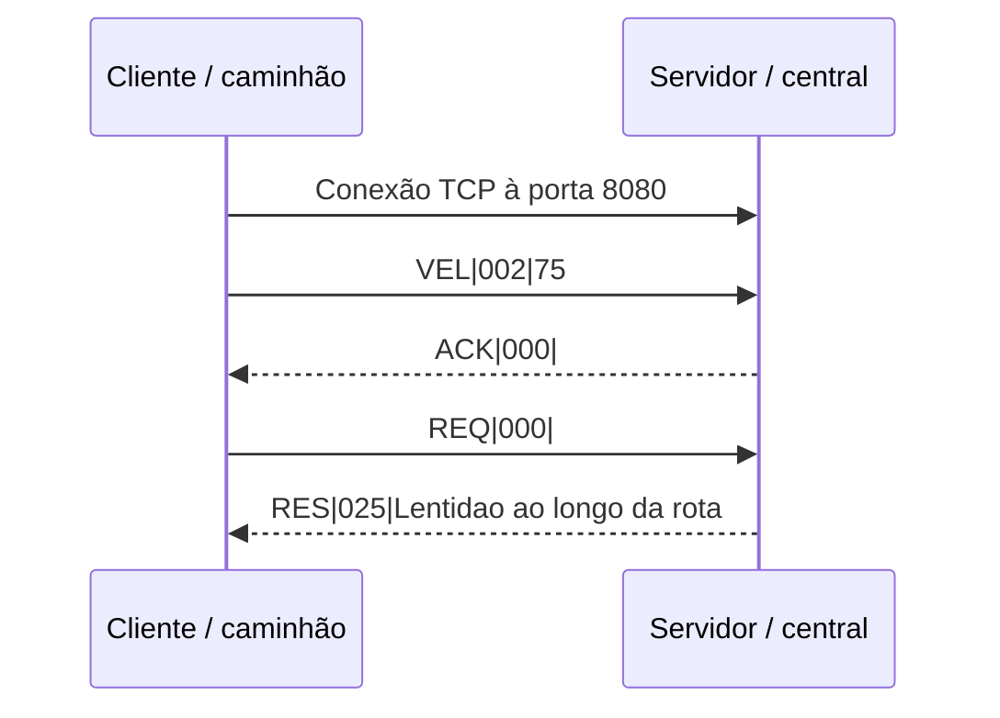

# PTR · Monitoramento de telemetria de frota

Projeto acadêmico de redes em C: um cliente simula um caminhão, envia sua velocidade a uma central e pode pedir uma atualização de rota. O servidor atende vários clientes simultaneamente usando **sockets TCP** e responde com mensagens do protocolo de aplicação **PTR**.

> **Comece por aqui:** este README explica o projeto no GitHub. Para uma demonstração visual e interativa, baixe o repositório e abra [guia-visual.html](guia-visual.html) no navegador. O GitHub exibe o código do HTML, mas não executa a página diretamente nessa visualização.

- [Executar pela primeira vez](#executar-pela-primeira-vez)
- [Entender a comunicação](#entender-a-comunicação)
- [Protocolo PTR](#protocolo-ptr)
- [Como o código funciona](#como-o-código-funciona)
- [Testar em máquinas diferentes](#testar-em-máquinas-diferentes)
- [Capturas de rede e defesa](#capturas-de-rede-e-defesa)

## Executar pela primeira vez

**Pré-requisitos:** Linux, GCC, `make` e bibliotecas de desenvolvimento C. Para os testes automatizados, Python 3. Em Ubuntu/Lubuntu:

```bash
sudo apt update
sudo apt install build-essential python3
```

Clone o repositório usando a URL fornecida pelo grupo e entre na pasta do projeto:

```bash
git clone URL_DO_REPOSITORIO
cd NOME_DO_REPOSITORIO/projeto2
make
./servidor
```

Deixe o servidor aberto. Em **outro terminal**, na mesma pasta:

```bash
./cliente 127.0.0.1
```

`127.0.0.1` é o próprio computador: serve para testar os dois programas localmente. O cliente envia uma velocidade imediatamente e depois a cada cinco segundos. Digite `REQ` e pressione Enter para pedir a rota; digite `SAIR` para desconectar. Use Ctrl+C para parar o servidor.

Exemplo de saída (o número muda porque a velocidade é simulada):

```text
Conectado. Velocidade a cada 5 segundos; digite REQ ou SAIR.
Enviado: VEL|002|75
Resposta: ACK|000|
REQ
Enviado: REQ|000|
Resposta: RES|025|Lentidao ao longo da rota
```

Abra mais terminais com `./cliente 127.0.0.1` para observar vários clientes conectados simultaneamente. Para verificar o projeto automaticamente, **pare o servidor antes** e execute:

```bash
make test
```

O teste usa a porta 8080; se ela estiver ocupada, o teste não consegue iniciar seu próprio servidor. `make clean` apaga os executáveis gerados, que podem ser recriados com `make`.

## Entender a comunicação


1. O servidor cria um socket, associa-o à porta TCP 8080 e aguarda conexões.
2. O cliente cria seu socket e conecta ao IP do servidor. O sistema escolhe uma porta de origem temporária.
3. Cada cliente envia uma velocidade simulada. O servidor lê e registra a mensagem no terminal e confirma com `ACK`.
4. Quando o usuário digita `REQ`, o servidor responde com um texto de rota em `RES`.
5. Cada conexão aceita tem uma thread de atendimento, permitindo que outros clientes sejam atendidos ao mesmo tempo.

**Por que TCP?** Ele oferece entrega confiável e ordenada, com retransmissão de dados perdidos. Isso simplifica o envio de registros e atualizações de rota, ao custo de mais sobrecarga e possíveis atrasos. UDP poderia ser escolhido em outro cenário que privilegiasse apenas a informação mais recente e aceitasse perdas. O `ACK` do PTR confirma o processamento pela aplicação; não é o mesmo que uma confirmação TCP nem prova gravação em disco.

## Protocolo PTR

Toda mensagem segue `TIPO|TAMANHO|CORPO`. O cabeçalho tem **8 bytes**: 3 do tipo, um `|`, 3 dígitos de tamanho e outro `|`. O tamanho conta os **bytes do corpo**, não inclui o cabeçalho nem um terminador NUL e vai de `000` a `999`.

```text
 VEL | 002 | 75
 └┬┘   └┬┘  └┬┘
 tipo   bytes  velocidade em km/h
```

O exemplo tem corpo `75`, com dois bytes ASCII. Os espaços no desenho só ajudam a ler; eles não fazem parte da mensagem real: `VEL|002|75`. O corpo pode conter `|`, pois é o comprimento que determina seu fim.

| Tipo | Quem envia | Exemplo | O que acontece |
|---|---|---|---|
| `VEL` | Cliente | `VEL|002|75` | Envia a velocidade; o servidor registra e responde `ACK`. O cliente simula entre 60 e 90; o servidor aceita de 1 a 3 dígitos. |
| `REQ` | Cliente | `REQ|000|` | Pede atualização de rota; o corpo deve ser vazio. |
| `RES` | Servidor | `RES|025|Lentidao ao longo da rota` | Entrega o texto de rota em resposta a `REQ`. |
| `ACK` | Servidor | `ACK|000|` | Confirma que o servidor processou uma mensagem `VEL` válida. |
| `ERR` | Servidor | `ERR|017|Payload incorreto` | Informa um comando ou corpo inválido. |

Um tipo desconhecido ou corpo inválido recebe `ERR` e a conexão continua. Cabeçalho inválido ou corpo com byte NUL recebe `ERR` e a conexão é encerrada; uma desconexão durante a mensagem encerra a leitura. O cliente só oferece os comandos interativos `REQ` e `SAIR`; `VEL` é enviado automaticamente.



## Como o código funciona

| Arquivo | Função |
|---|---|
| [servidor.c](projeto2/servidor.c) | Abre o socket, faz `bind`, `listen` e `accept`; cria uma thread por conexão e decide entre `RES`, `ACK` e `ERR`. |
| [cliente.c](projeto2/cliente.c) | Conecta ao IP informado; gera velocidades, espera até cinco segundos com `select` e aceita `REQ` ou `SAIR`. |
| [ptr.h](projeto2/ptr.h) | Código compartilhado de enquadramento, leitura e envio das mensagens. |
| [teste.py](projeto2/teste.py) | Exercita o servidor por sockets reais, incluindo clientes simultâneos, fragmentação e mensagens inválidas. |
| [Makefile](projeto2/Makefile) | Compila os programas e oferece `make test` e `make clean`. |
| [RELATORIO.md](projeto2/RELATORIO.md) | Relatório acadêmico com especificação, arquitetura e análise da captura. |

### O que acontece em cada função

- **`main` do servidor:** `socket` cria o ponto de comunicação; `bind` associa a porta 8080 a todas as interfaces IPv4; `listen` aguarda conexões; `accept` cria um socket para cada cliente. `pthread_create` inicia seu atendimento.
- **`atender`:** lê mensagens enquanto a conexão estiver ativa. Para `REQ` vazio devolve `RES`; para `VEL` com um a três dígitos, `ACK`; para dados inválidos, `ERR`. Imprime o tipo e o corpo recebidos.
- **`main` do cliente:** valida o IPv4 com `inet_pton`, conecta com `connect` e inicializa o gerador aleatório. `select` permite aguardar comandos sem impedir o envio periódico.
- **`trocar`:** envia uma mensagem e espera a resposta antes da próxima troca, exibindo ambas.
- **`ptr_enviar` / `ptr_receber`:** montam e interpretam o cabeçalho de tamanho fixo, validam seus separadores e dígitos e tratam o corpo de até 999 bytes.
- **`ptr_io`:** repete `send` ou `recv` até transferir a quantidade necessária. Isso importa porque TCP é um **fluxo de bytes**: uma chamada pode receber só parte de uma mensagem ou várias mensagens podem chegar juntas.

## Testar em máquinas diferentes

1. Coloque as máquinas na mesma rede. Se usar VirtualBox, configure a placa da VM como **Adaptador em modo Bridge** e selecione a interface física conectada. Confira com `ip -4 addr`.
2. Na máquina que será a central, execute `make` e `./servidor`. Descubra seu IPv4 com `ip -4 addr`.
3. Na máquina do cliente, execute `make` e `./cliente IP_DO_SERVIDOR`, substituindo pelo IP descoberto. Não use `127.0.0.1` para acessar outra máquina.
4. Se não conectar, confira o IP atual, o modo Bridge, a rede, o firewall e se a porta TCP 8080 está livre e acessível.

Os IPs das capturas são de uma execução anterior; o DHCP pode fornecer valores diferentes. A rede Wi-Fi também pode impedir a comunicação entre dispositivos.

## Capturas de rede e defesa

O grupo já testou em Bridge: a VM `192.168.254.184:57882` conectou ao servidor `192.168.254.40:8080` naquela execução. A captura inclui o estabelecimento TCP e os dados PTR:

- [Wireshark: pacotes e camadas](projeto2/wireshark-bridge.png)
- [Netstat: conexão estabelecida](projeto2/netstat-bridge.png)
- [Arquivo de captura para abrir no Wireshark](projeto2/trafego-bridge.pcapng)
- [Relatório em PDF para entrega](projeto2/RELATORIO.pdf) · [versão editável em Markdown](projeto2/RELATORIO.md)

Para reproduzir, instale `wireshark` e `net-tools`, capture na interface correta, filtre `tcp.port == 8080` no Wireshark e execute `netstat -tn` com a conexão ativa. No Wireshark, selecione um pacote com dados: PTR é o conteúdo; TCP traz portas e números de sequência; IPv4 traz endereços; o enlace depende da interface observada. Clique em **Follow → TCP Stream** para ver a conversa em texto.

### Perguntas que podem aparecer na defesa

- **Qual a diferença entre TCP e PTR?** TCP transporta um fluxo confiável de bytes; PTR define o significado e o formato das mensagens dentro desse fluxo.
- **Por que há leituras repetidas?** Uma chamada a `recv` não garante que todo o cabeçalho ou corpo tenha chegado.
- **Qual a diferença entre IP e porta?** O IP identifica a máquina/interface na rede; a porta identifica o ponto de comunicação da aplicação naquela máquina.
- **O que faz o Bridge?** Conecta a interface virtual à rede física, permitindo que a VM tenha seu próprio endereço nessa rede.
- **Onde os dados são guardados?** Neste projeto são impressos no terminal do servidor; não há banco de dados nem arquivo persistente.
- **O sistema é seguro para produção?** Não: é uma demonstração acadêmica sem autenticação, criptografia ou identificação persistente dos caminhões.

A defesa está marcada para **25/11 às 21h15**. Equipe: **Warmi, Andrias, Yasmin e Davi Campos**. Cada integrante deve conhecer a implementação para a defesa individual.
