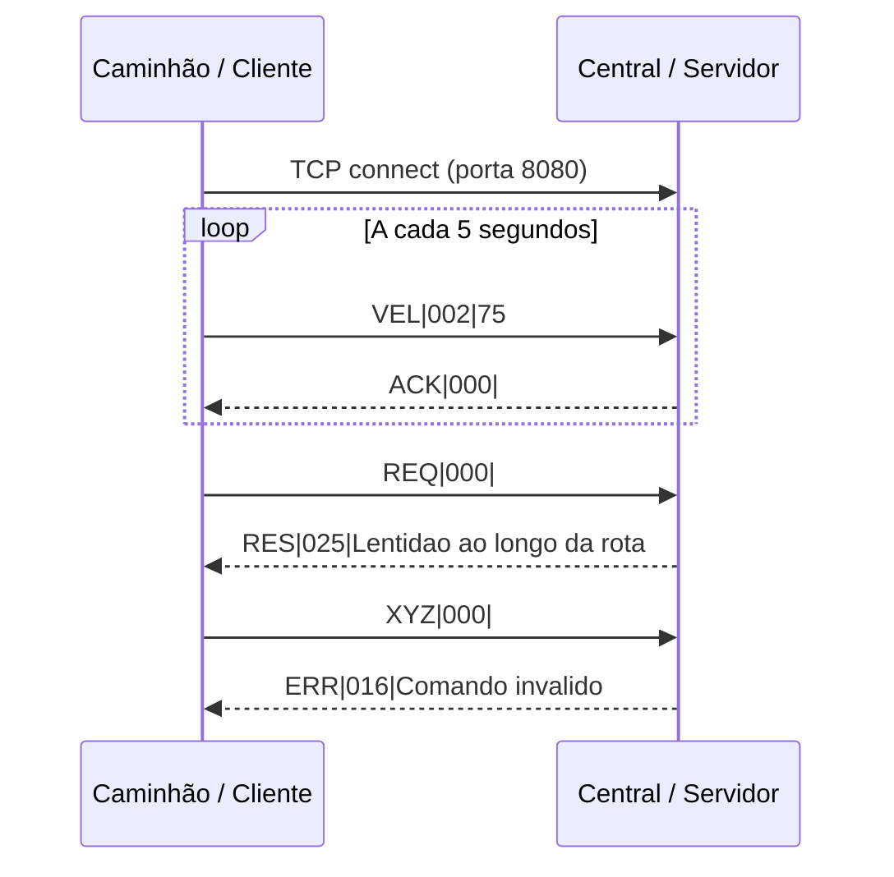
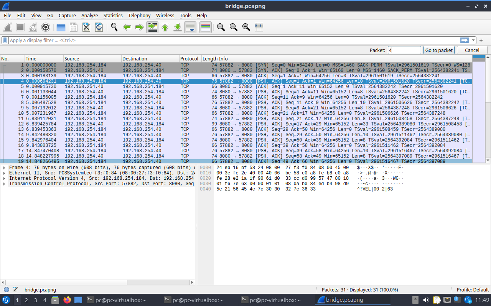
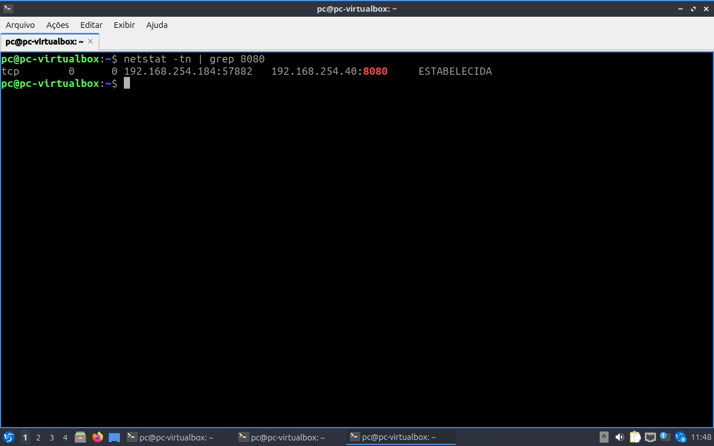

# Projeto 2 — Monitoramento de Telemetria de Frota

**Equipe:** preencher nomes e turma  
**Data:** preencher  
**Disciplina:** Redes de Computadores

## 1. Objetivo e solução

Um cliente representa um caminhão e envia ao servidor, a cada cinco segundos, uma velocidade simulada entre 60 e 90 km/h. O usuário também pode solicitar uma atualização de rota com `REQ`. O servidor recebe vários clientes simultaneamente, registra as mensagens na saída do terminal e responde pelo protocolo PTR. Cada conexão é atendida por uma thread. O registro é exibido no terminal e não é persistido em arquivo.

## 2. Protocolo de transporte

Foi escolhido **TCP**, que fornece fluxo confiável e ordenado, com retransmissão de segmentos perdidos. Isso é adequado para confirmar o recebimento das velocidades e entregar atualizações de rota sem exigir que a aplicação implemente essa confiabilidade. A conexão e as retransmissões geram custo e podem aumentar a latência; em um sistema que privilegiasse apenas a leitura mais recente, UDP poderia ser uma alternativa. O ACK do PTR é uma confirmação da aplicação, diferente do ACK do próprio TCP e não garante armazenamento persistente.

O servidor escuta em IPv4, porta TCP **8080**. Cada cliente conecta a partir de uma porta de origem efêmera escolhida pelo sistema operacional. TCP não preserva fronteiras de mensagens: a implementação lê exatamente os oito bytes do cabeçalho e depois a quantidade de bytes declarada para o corpo, inclusive quando a mensagem chega em partes ou várias mensagens chegam juntas.

## 3. Protocolo de aplicação PTR

A sintaxe é `TIPO|TAMANHO|CORPO`: `TIPO` possui três caracteres, `TAMANHO` tem exatamente três algarismos decimais e informa o número de **bytes** do corpo, de 000 a 999. O cabeçalho tem oito bytes, incluindo os dois delimitadores. O corpo é texto sem byte NUL; a contagem não inclui terminador NUL. Exemplos usam ASCII, em que cada caractere mostrado ocupa um byte. O corpo pode conter `|`, pois seu fim é determinado pelo comprimento, não pelo delimitador.

| Tipo | Origem | Corpo e comportamento |
|---|---|---|
| `REQ` | Cliente | Vazio: `REQ|000|`. Pede uma atualização; o servidor responde com `RES`. |
| `RES` | Servidor | Texto de atualização, por exemplo `RES|025|Lentidao ao longo da rota`. |
| `VEL` | Cliente | Um a três algarismos decimais, de 0 a 999 km/h. O cliente deste projeto gera valores entre 60 e 90; por exemplo `VEL|002|75`. O servidor registra e responde `ACK`. |
| `ACK` | Servidor | Corpo vazio: `ACK|000|`. Confirma o processamento de `VEL`. |
| `ERR` | Servidor | Descrição textual do erro, por exemplo `ERR|017|Payload incorreto`. |

O servidor responde `ERR` a tipo desconhecido ou corpo inadequado, mantendo a conexão. Cabeçalho inválido ou corpo com byte NUL produz `ERR` seguido de fechamento da conexão, pois o fluxo não pode ser reenquadrado com segurança. Se uma conexão terminar no meio de uma mensagem, ela é encerrada sem resposta. O cliente exibe a resposta recebida e encerra se a conexão falhar ou o enquadramento da resposta for inválido.



## 4. Arquitetura e camadas

```text
Caminhão A: cliente C ─┐
Caminhão B: cliente C ─┼── rede IPv4 / Ethernet ou Wi-Fi ── Central: servidor C
Caminhão N: cliente C ─┘                                      TCP 8080

Aplicação:  PTR (REQ, RES, VEL, ACK, ERR)
Transporte: TCP (porta efêmera do cliente ↔ porta 8080 do servidor)
Rede:       IPv4 (IP do cliente ↔ IP do servidor)
Enlace:     Ethernet ou Wi-Fi, conforme a rede usada
```

No VirtualBox, configurar o adaptador como **Placa em modo Bridge** permite que a VM participe da rede física. Obter o endereço da máquina do servidor com `ip -4 addr`; usar esse IPv4 no cliente. O funcionamento depende de a rede permitir comunicação entre as máquinas e da liberação da porta TCP 8080 no firewall. É possível demonstrar localmente com `127.0.0.1`, embora loopback não demonstre a comunicação pela interface em bridge.

## 5. Compilação e execução

Em Linux, com GCC, make e pthreads instalados, na pasta `projeto2`:

```sh
make
./servidor
```

Em outro terminal ou máquina com o cliente compilado:

```sh
./cliente 127.0.0.1
# ou: ./cliente IP_DA_MAQUINA_SERVIDORA
```

O cliente envia velocidades automaticamente. Digite `REQ` e pressione Enter para solicitar rota; digite `SAIR` para encerrar. Abra outros clientes para demonstrar simultaneidade. Encerre o servidor com Ctrl+C. `make test` executa o teste automatizado (requer Python 3 e porta 8080 livre); `make clean` remove os executáveis.

## 6. Análise de tráfego

A captura foi realizada com o cliente na VM Linux do VirtualBox, configurada em **Bridge** sobre a interface Wi-Fi `wlp0s20f3` do anfitrião. A VM recebeu `192.168.254.184` e o computador servidor usou `192.168.254.40`. Na VM, a captura foi feita na interface `enp0s3` com filtro de captura `tcp port 8080`. O arquivo [trafego-bridge.pcapng](trafego-bridge.pcapng) pode ser aberto no Wireshark.



Os três primeiros pacotes mostram o estabelecimento da conexão TCP: SYN, SYN-ACK e ACK. O pacote 4, selecionado na imagem, vai de `192.168.254.184:57882` para `192.168.254.40:8080` e contém a mensagem `VEL|002|63`, visível nos bytes finais. A porta 57882 é efêmera; 8080 é a porta do servidor. Nas respostas, os endereços e portas se invertem. Durante o teste também foram trocadas `REQ`, `RES` e confirmações `ACK` do PTR.

O Wireshark mostra o encapsulamento: o texto PTR é transportado como dados de aplicação em um segmento TCP; o segmento é encapsulado em IPv4 e, na interface virtual da VM, em Ethernet II. O cabeçalho TCP apresenta portas, números de sequência e confirmações TCP, que são diferentes do `ACK` da aplicação. Os endereços MAC mostrados pertencem ao enlace observado na interface virtual; o adaptador físico do anfitrião utiliza Wi-Fi.

O `netstat` na VM mostrou a conexão estabelecida com a mesma combinação de endereços e portas. O filtro `grep 8080` seleciona a linha da aplicação:



Para repetir o teste, verifique os IPs atuais com `ip -4 addr`, inicie o servidor e o cliente conforme a seção 5, filtre por `tcp.port == 8080` no Wireshark e execute `netstat -tn` durante a conexão. Endereços e portas efêmeras podem mudar entre execuções.

## 7. Verificação e limites

O teste automatizado verifica duas conexões simultâneas, cabeçalho fragmentado, mensagens concatenadas, `REQ`, `VEL`, comando desconhecido e corpos inválidos. A solução é uma demonstração acadêmica: não possui criptografia, autenticação, persistência de dados ou identificação estável dos veículos. O endereço IP e a porta identificam a conexão, mas não identificam permanentemente um caminhão.
